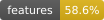
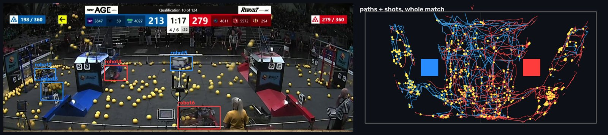
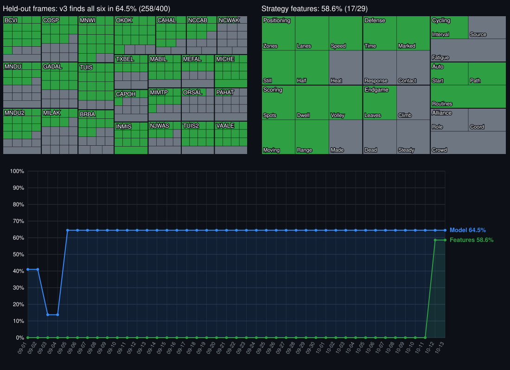

### `Project Tengen`

[](https://github.com/NHH-Inc/Project-Tengen/actions/workflows/ci.yml)
[](docs/MODELS.md)
[](docs/STRATEGY-PLAN.md#the-feature-catalogue-layer-3)
[](https://discord.gg/sZqMP3JEbb)

Tengen watches FRC match video and works out **how each team plays, and how to beat it**:
where a robot shoots from and how long it sits there, its auto, its cycles, its defense, when it
heads for the endgame. It runs offline on a laptop in the stands.

<div flex="true">
  <a href="docs/DESKTOP.md">Run it</a>
  •
  <a href="docs/STRATEGY-PLAN.md">The plan</a>
  •
  <a href="docs/MODELS.md">Models</a>
  •
  <a href="docs/IMPROVING-THE-MODEL.md">Improve the model</a>
  •
  <a href="docs/frc-scouting-0-contract.md">Doc 0</a>
  •
  <a href="https://discord.gg/sZqMP3JEbb">Discord</a>
</div>

<br clear="left"/>



<sub>2026 Championship, Curie qualification 10. Left: the six robots Tengen tracks. Right: every
path and shot (yellow) of the match from above, from the field's own AprilTags.</sub>

## What it does

- **Finds and follows all six robots** in a broadcast, a phone recording or a webcam, and keeps
  who is who through occlusion.
- **Puts them on the field.** Positions in feet from the field's AprilTags, red rotated onto blue
  so a team's matches line up whichever alliance it was on.
- **Reads the match clock** off the scoreboard, so auto, teleop and endgame are where the referees
  had them, not where the clip happens to start.
- **Measures behaviour:** shooting spots and dwell, volley timing, start position and auto path,
  zones and lanes, defense and who was marked, endgame timing.
- **Builds team profiles and counters.** Every claim carries how many matches it rests on, and
  links back to the video.

## Status

[](docs/MODELS.md) [](docs/STRATEGY-PLAN.md#the-feature-catalogue-layer-3) [](docs/MODELS.md) [](docs/MODELS.md)

[](docs/MODELS.md)

[Every model and its scores](docs/MODELS.md)

<sub>* Held-out: the share of 400 frames of real 2026 broadcasts, from 25 events no model has
trained on, where the current model finds all six robots. One cell per frame, one block per event;
hover a cell for its frame. Features: the strategy features of the
[plan's catalogue](docs/STRATEGY-PLAN.md#the-feature-catalogue-layer-3) that are built, one cell
each. Tracked: share of a real match with all six robots tracked at once. Everything is generated
from [`training/registry`](training/registry) and
[`catalogue.py`](ingest/strategy/catalogue.py) by `python -m tools.status`, never typed in.</sub>

## Quick start

The desktop app needs no server, browser or database.

```powershell
py -3.13 -m venv .venv-desktop
.venv-desktop\Scripts\python -m pip install -r requirements-desktop.txt
.venv-desktop\Scripts\python tengen.py
```

Then double-click **`Launch Tengen.cmd`** next time (on a Mac, `./setup-desktop.sh` and
**`Launch Tengen.command`**). **Open video…**, then **Analyze video…**, then the **Strategy** tab.
Details: [DESKTOP.md](docs/DESKTOP.md). The web app and ingest service:
[WEB-AND-API.md](docs/WEB-AND-API.md).

## How it works

```
video ─▶ detect + track ─▶ timeline ─▶ features ─▶ profile ─▶ counters
         (YOLO11, six      (10 Hz, field  (spots, dwell,  (per team,   (advice with
          identities,       feet, match    volleys, auto,  with n)      its evidence)
          AprilTags,        clock)         defense)
          shots)
```

| | |
|---|---|
| [Doc 0](docs/frc-scouting-0-contract.md) | The shared contract. Read first. |
| [Strategy plan](docs/STRATEGY-PLAN.md) | Where Tengen is going and what is measured so far |
| [Models](docs/MODELS.md) | Every detector, numbered, with its scores |
| [Improving the model](docs/IMPROVING-THE-MODEL.md) | Step by step, from a match to a better model |
| [Desktop](docs/DESKTOP.md) · [Web and API](docs/WEB-AND-API.md) · [Running](docs/RUNNING.md) | Using it |
| [Training](docs/TRAINING.md) · [Labelling](docs/LABELLING.md) | Building models |
| [Decisions](docs/DECISIONS.md) | Why things are the way they are |

## Team

Built by FRC students: Justin ([@ComplexKing](https://github.com/ComplexKing)), Robert
([@rtrod](https://github.com/rtrod)) and Nathaniel ([@shenjiatv-jpg](https://github.com/shenjiatv-jpg)).
Questions, footage and help are welcome on [Discord](https://discord.gg/sZqMP3JEbb).

## Credits and disclaimer

FIRST®, FRC® and REBUILT™ are trademarks of FIRST. Tengen is an independent student project and
is not affiliated with or endorsed by FIRST. Match frames shown here come from public FIRST
broadcasts. The 2026 AprilTag layout is WPILib's (BSD-3-Clause, see
[its attribution](contracts/fields/2026-apriltags.ATTRIBUTION.md)); the first training images came
from two CC BY 4.0 Roboflow Universe datasets.
