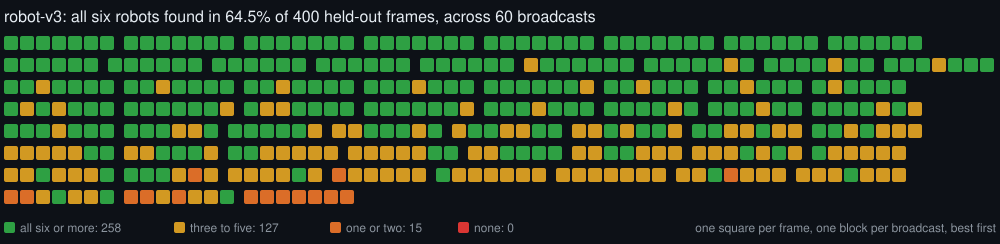

# Models

Every robot detector Tengen has had, numbered. Generated by `python -m tools.models markdown`
from [`training/registry/`](../training/registry/); edit the registry, not this file.

**How to read it.** The held-out columns are the same v3-viewpoint
pack of 400 real 2026 broadcast frames for every model, so they compare across versions. Each
model's own val mAP was measured on its own val split, so it does **not** compare across versions,
and a higher val mAP has more than once come with a worse model on real footage. "Match: all 6
tracked" measures the whole pipeline (detector plus tracking and identity) on one real match.

| Model | Status | Trained | By | Network | Held-out: all 6 found | Mean robots/frame | Blind frames | Match: all 6 tracked | Own val mAP50 / 50-95 |
|---|---|---|---|---|---|---|---|---|---|
| **v3** ⭐ | current | 2026-09-05 | Robert | YOLO11n @ 640 | 64.5% | 6.34 | 0 | 68.0% | 0.973 / 0.544 |
| **v3-640** | retired | 2026-09-05 | Robert | YOLO11n @ 640 | 51.7% | 5.61 | 7 | — | 0.973 / 0.544 |
| **v2** | retired | 2026-09-03 | Justin | YOLO11n @ 960 | 13.8% | 3.47 | 13 | — | 0.900 / 0.595 |
| **v1** | retired | 2026-09-01 | Robert | YOLO11n @ 960 | 41.0% | 5.00 | 5 | — | 0.908 / 0.602 |

### v3 — robot-v3 (current)

- **Trained** 2026-09-05 by Robert: YOLO11n, 100 epochs at 640 px.
- **Data** robot-yolo11n-reviewed-aug: over 1,000 images reviewed by hand in Robert's labeller, with augmentation.
- **Its own val split** P 0.947, R 0.957, mAP50 0.973, mAP50-95 0.544.
- **Held-out** (400 frames, 960 px input, evaluated 2026-10-13): all six robots in 64.5% of frames, mean 6.34, 0 blind.
- **Whole pipeline** on 2026 Championship Curie qm10: all six tracked 68% of the match, at least five 91%. With the identity fix in fe374d1; before it, 0.25 and 0.35. This measures the whole tracking pipeline, not the detector alone.
- **Training curves** [`results.png`](../training/registry/runs/v3/results.png)
- Trained at 640 px, exported for 960 px input, which scores better on held-out footage. In use by the desktop app and the analyzer.

### v3-640 — robot-v3 (640 export)

- **Trained** 2026-09-05 by Robert: YOLO11n, 100 epochs at 640 px.
- **Data** robot-yolo11n-reviewed-aug: over 1,000 images reviewed by hand in Robert's labeller, with augmentation.
- **Its own val split** P 0.947, R 0.957, mAP50 0.973, mAP50-95 0.544.
- **Held-out** (400 frames, 640 px input, evaluated 2026-10-13): all six robots in 51.7% of frames, mean 5.61, 7 blind.
- **Training curves** [`results.png`](../training/registry/runs/v3/results.png)
- The same weights as v3, exported for 640 px input. Posted in #model-training on 2026-09-06.

### v2 — robot-v2

- **Trained** 2026-09-03 by Justin: YOLO11n, 150 epochs at 960 px.
- **Data** frc-robots-v2: the merged set plus 1,017 machine-labelled 2026 match frames (detector corroborated by temporal persistence); 3,446 images.
- **Its own val split** P 0.862, R 0.864, mAP50 0.900, mAP50-95 0.595.
- **Held-out** (400 frames, 960 px input, evaluated 2026-10-13): all six robots in 13.8% of frames, mean 3.47, 13 blind.
- **Training curves** [`results.png`](../training/registry/runs/v2/results.png)
- Trained on the AMD RX 7800 XT through ROCm in WSL. Nearly blind to the lower panel of stacked broadcasts.

### v1 — robot-v1

- **Trained** 2026-09-01 by Robert: YOLO11n, 100 epochs at 960 px.
- **Data** frc-robots-merged: 2,429 human-labelled images from two CC BY 4.0 Roboflow datasets, splits rebuilt by source image.
- **Its own val split** P 0.843, R 0.857, mAP50 0.908, mAP50-95 0.602.
- **Held-out** (400 frames, 960 px input, evaluated 2026-10-13): all six robots in 41.0% of frames, mean 5.00, 5 blind.
- The first detector. Its val split is not v2's or v3's, so these numbers do not compare across versions; the held-out score does.

## Adding a model

See [IMPROVING-THE-MODEL.md](IMPROVING-THE-MODEL.md). In short: add an entry to
`training/registry/models.json` with the next number, put its ONNX in `data/`, run
`python -m tools.models evaluate --only vN`, then `python -m tools.status` and
`python -m tools.models markdown`. It becomes `current` only if it beats the current model on
every held-out pack.
